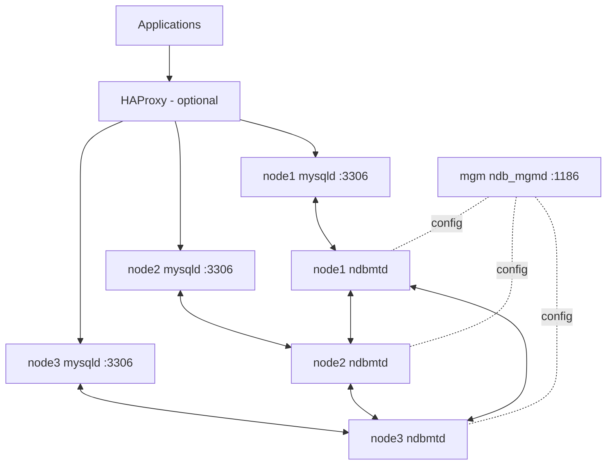

# MySQL NDB Cluster on Physical Servers: Step-by-Step Guide

A 1 manager + 3 data/SQL node cluster, built and verified on MySQL NDB Cluster **26.10.0**.

---

## 1. Concepts

NDB Cluster stores data **in RAM across several machines** and keeps a copy on each. Three kinds of node cooperate:

| Node type | Program | Job |
|---|---|---|
| Management node | `ndb_mgmd` | Holds `config.ini`, tells nodes who is who, acts as arbitrator |
| Data node | `ndbmtd` | Stores the data and its replicas (multi-threaded) |
| SQL node | `mysqld` | The normal MySQL server your applications connect to |

Applications talk **only to SQL nodes** (port 3306). SQL nodes read and write through the data nodes. The manager is not in the data path; it coordinates.

**Replicas.** The number of data nodes must be a multiple of `NoOfReplicas`. This guide uses `NoOfReplicas=3` with 3 data nodes: one node group, each node holds a full copy, and any two nodes can fail without data loss. (A common production layout is `NoOfReplicas=2` with 2 or 4 data nodes, which gives more capacity per server.)

---

## 2. Infrastructure

### 2.1 Servers

| Hostname | IP | Runs | Role |
|---|---|---|---|
| `mgm` | 172.15.14.176 | `ndb_mgmd` | Management node (NodeId 1) |
| `node1` | 172.15.14.161 | `ndbmtd` + `mysqld` | Data node 2, SQL node 11 |
| `node2` | 172.15.14.162 | `ndbmtd` + `mysqld` | Data node 3, SQL node 12 |
| `node3` | 172.15.14.163 | `ndbmtd` + `mysqld` | Data node 4, SQL node 13 |

### 2.2 Topology diagram

```
                  Applications / clients
                          |
                   (optional) HAProxy
                          | :3306
        +-----------------+-----------------+
        |                 |                 |
   +----v-----+      +----v-----+      +----v-----+
   |  node1   |      |  node2   |      |  node3   |
   | mysqld   |      | mysqld   |      | mysqld   |   <- SQL nodes (11, 12, 13)
   | ndbmtd   |<---->| ndbmtd   |<---->| ndbmtd   |   <- Data nodes (2, 3, 4)
   +----^-----+      +----^-----+      +----^-----+
        |                 |                 |
        +-----------------+-----------------+
                          | :1186
                    +-----v------+
                    |    mgm     |
                    |  ndb_mgmd  |                    <- Management node (1)
                    +------------+
```



### 2.3 Hardware guidance (physical servers)

| Item | Recommendation | Why |
|---|---|---|
| RAM (data nodes) | At least 1.5x to 2x the `DataMemory` you plan to set | NDB keeps all data in RAM; running out of RAM crashes the node |
| CPU (data nodes) | 4+ cores | `ndbmtd` is multi-threaded |
| Disk (data nodes) | SSD/NVMe for `DataDir` | Checkpoints and redo logs are written continuously |
| Disk (manager) | Small is fine | Holds only config and logs |
| Network | Dedicated subnet, 1 Gbit minimum, 10 Gbit preferred, wired | Nodes exchange heartbeats and data constantly; latency and packet loss cause node failures |
| Time sync | `chrony` or NTP on every server | Log correlation and fewer odd timing issues |
| Power | UPS, and spread nodes across separate power circuits if possible | Replicas only help if servers do not fail together |

All four servers must run the **same cluster version** and be reachable by fixed IPs.

---

## 3. Preparation (all 4 servers)

### 3.1 Set hostnames and static IPs

Give every server a fixed IP. A node whose IP changes drops out of the cluster. Add names to `/etc/hosts` on every server:

```bash
sudo tee -a /etc/hosts <<'EOF'
172.15.14.176 mgm
172.15.14.161 node1
172.15.14.162 node2
172.15.14.163 node3
EOF
```

Check connectivity from each server:

```bash
ping -c 2 mgm && ping -c 2 node1 && ping -c 2 node2 && ping -c 2 node3
```

### 3.2 Check the CPU architecture

```bash
uname -m
```

`x86_64` needs the x86 tarball; `aarch64` needs the ARM tarball. The **version number must be identical** on all servers.

### 3.3 Install dependencies

```bash
sudo apt update
sudo apt install -y libaio1t64 libncurses6 libnuma1 xz-utils
```

On recent Ubuntu/Debian the package is `libaio1t64`, which ships `libaio.so.1t64`. MySQL looks for `libaio.so.1`, so add a symlink (adjust the folder for your architecture: `x86_64-linux-gnu` or `aarch64-linux-gnu`):

```bash
LIBDIR=/usr/lib/$(uname -m)-linux-gnu
[ -e $LIBDIR/libaio.so.1 ] || sudo ln -s $LIBDIR/libaio.so.1t64 $LIBDIR/libaio.so.1
sudo ldconfig
```

### 3.4 Firewall

If `ufw` is active, allow the cluster subnet. Data nodes use dynamic ports by default, so allowing the whole subnet is simplest:

```bash
sudo ufw allow from 172.15.14.0/24
```

At minimum, port **1186** (manager) and **3306** (SQL) must be reachable. Do **not** expose these ports to the internet; keep the cluster on a private network.

### 3.5 Create the `mysql` user

```bash
sudo groupadd mysql
sudo useradd -r -g mysql -s /bin/false mysql
```

---

## 4. Install the software (all 4 servers)

Download **MySQL NDB Cluster 26.10.0, Linux - Generic** from `dev.mysql.com/downloads/cluster/`:

| Architecture | File |
|---|---|
| x86_64 | `mysql-cluster-26.10.0-linux-glibc2.28-x86_64.tar.xz` |
| aarch64 | `mysql-cluster-26.10.0-linux-glibc2.28-aarch64.tar.xz` |

Verify the download against the MD5 on the page:

```bash
md5sum mysql-cluster-26.10.0-*.tar.xz
```

Copy the file to each server if needed (`scp`, or a temporary `python3 -m http.server 8000` on the machine that has it, then `wget`). Then on **every** server:

```bash
cd /usr/local
sudo tar xf ~/mysql-cluster-26.10.0-linux-glibc2.28-*.tar.xz
sudo ln -s /usr/local/mysql-cluster-26.10.0-linux-glibc2.28-* /usr/local/mysql
echo 'export PATH="$PATH:/usr/local/mysql/bin"' | sudo tee /etc/profile.d/mysql-cluster.sh
source /etc/profile.d/mysql-cluster.sh
```

Verify:

```bash
ndb_mgmd --version
```

> **Warning:** always use `export PATH="$PATH:..."`. Writing `export PATH="..."` without `$PATH:` replaces the whole PATH and breaks basic commands.

> **Warning:** Ubuntu's own `mysql-server` package puts a different `mysqld` in `/usr/sbin`. Do not use it. Check with `which mysqld` that you are running `/usr/local/mysql/bin/mysqld`.

---

## 5. Management node (`mgm`)

### 5.1 Create the config

```bash
sudo mkdir -p /var/lib/mysql-cluster
sudo nano /var/lib/mysql-cluster/config.ini
```

```ini
[ndbd default]
NoOfReplicas=3
DataMemory=2G
DataDir=/var/lib/mysql-cluster

[ndb_mgmd]
NodeId=1
HostName=172.15.14.176
DataDir=/var/lib/mysql-cluster

[ndbd]
NodeId=2
HostName=172.15.14.161

[ndbd]
NodeId=3
HostName=172.15.14.162

[ndbd]
NodeId=4
HostName=172.15.14.163

[mysqld]
NodeId=11
HostName=172.15.14.161

[mysqld]
NodeId=12
HostName=172.15.14.162

[mysqld]
NodeId=13
HostName=172.15.14.163
```

| Setting | Meaning |
|---|---|
| `NoOfReplicas=3` | Copies of every row; one node group of three |
| `DataMemory` | RAM per data node for your data. Size it to your dataset; the lab used 256M, physical servers can use much more |
| `DataDir` | Where each node keeps logs and checkpoints (a path on **that** node) |
| `NodeId` | Fixed identity of a node |
| `HostName` | Only this IP may take that NodeId |

### 5.2 Start the manager (first time only)

```bash
sudo ndb_mgmd --initial -f /var/lib/mysql-cluster/config.ini --configdir=/var/lib/mysql-cluster
```

`ndb_mgmd` runs in the background. Do **not** run the command a second time while it is running (error: *Address already in use*). To stop it: `ndb_mgm -e shutdown`.

### 5.3 Check

```bash
ndb_mgm -e show
```

You should see node 1 connected and the others "not connected". That is correct for now.

---

## 6. Data nodes (`node1`, `node2`, `node3`)

On each data node:

```bash
sudo mkdir -p /var/lib/mysql-cluster
sudo chown -R mysql:mysql /var/lib/mysql-cluster
sudo ndbmtd --initial --ndb-connectstring=172.15.14.176
```

> **Warning:** `--initial` wipes the node's data files. Use it **only on the very first start** (or when you intentionally rebuild a node). Every later start is `ndbmtd --ndb-connectstring=172.15.14.176` with no `--initial`.

Start node1, node2, then node3. With 3 replicas the cluster waits for all three before it becomes usable. Check from the manager:

```bash
ndb_mgm -e show
ndb_mgm -e "all status"
```

Expected: each `ndbd` shows `Nodegroup: 0`.

---

## 7. SQL nodes (`node1`, `node2`, `node3`)

### 7.1 Config file

```bash
sudo nano /etc/my.cnf
```

```ini
[mysqld]
ndbcluster
ndb-connectstring=172.15.14.176
user=mysql
basedir=/usr/local/mysql
datadir=/var/lib/mysql

[mysql_cluster]
ndb-connectstring=172.15.14.176
```

`ndbcluster` enables the NDB engine. `ndb-connectstring` points to the manager.

### 7.2 Initialize and start

```bash
sudo mkdir -p /var/lib/mysql
sudo chown -R mysql:mysql /var/lib/mysql
sudo /usr/local/mysql/bin/mysqld --initialize-insecure --user=mysql
sudo /usr/local/mysql/bin/mysqld --user=mysql &
```

`--initialize-insecure` creates `root` with an empty password. The initialize log may show `sched_setaffinity() failed` (harmless) and `ndbcluster plugin disabled` (the plugin is only off during initialization).

### 7.3 Set a root password

```bash
mysql -u root
```

```sql
ALTER USER 'root'@'localhost' IDENTIFIED BY 'ChooseAStrongPassword';
```

### 7.4 Check

On the manager, `ndb_mgm -e show` should now show nodes 11, 12 and 13 connected.

---

## 8. Verify replication

On **node1**:

```sql
CREATE DATABASE clusterdb;
USE clusterdb;
CREATE TABLE test (id INT PRIMARY KEY AUTO_INCREMENT, name VARCHAR(50)) ENGINE=NDBCLUSTER;
INSERT INTO test (name) VALUES ('hello from node1');
```

On **node2** and **node3**:

```sql
SELECT * FROM clusterdb.test;
```

If you see "Unknown database", run `CREATE DATABASE clusterdb;` on that node (databases are per SQL node; NDB tables are shared). Then insert on node3 and read on node1 to prove every direction works.

> Only `ENGINE=NDBCLUSTER` tables are shared. InnoDB tables stay local to one SQL node.

---

## 9. Start on boot (systemd)

Create these units **after** the first manual start has worked. Remember the services must not use `--initial`.

### 9.1 Manager (`mgm`): `/etc/systemd/system/ndb_mgmd.service`

```ini
[Unit]
Description=NDB Cluster Management Server
After=network-online.target
Wants=network-online.target

[Service]
User=mysql
ExecStart=/usr/local/mysql/bin/ndb_mgmd -f /var/lib/mysql-cluster/config.ini --configdir=/var/lib/mysql-cluster --nodaemon
Restart=on-failure

[Install]
WantedBy=multi-user.target
```

### 9.2 Data nodes: `/etc/systemd/system/ndbmtd.service`

```ini
[Unit]
Description=NDB Cluster Data Node
After=network-online.target
Wants=network-online.target

[Service]
User=mysql
ExecStart=/usr/local/mysql/bin/ndbmtd --ndb-connectstring=172.15.14.176 --nodaemon
Restart=on-failure

[Install]
WantedBy=multi-user.target
```

### 9.3 SQL nodes: `/etc/systemd/system/mysqld-cluster.service`

```ini
[Unit]
Description=MySQL Cluster SQL Node
After=ndbmtd.service
Wants=ndbmtd.service

[Service]
User=mysql
ExecStart=/usr/local/mysql/bin/mysqld --defaults-file=/etc/my.cnf
Restart=on-failure
LimitNOFILE=65535

[Install]
WantedBy=multi-user.target
```

Enable them (stop the manually started processes first):

```bash
sudo systemctl daemon-reload
sudo systemctl enable --now ndb_mgmd        # on mgm
sudo systemctl enable --now ndbmtd          # on data nodes
sudo systemctl enable --now mysqld-cluster  # on SQL nodes
```

**Start order after a full power loss:** manager, then data nodes, then SQL nodes.

---

## 10. Operations

### 10.1 Management commands

```bash
ndb_mgm                      # interactive console
ndb_mgm -e show              # cluster overview
ndb_mgm -e "all status"      # status of data nodes
ndb_mgm -e "all report memory"   # DataMemory usage
ndb_mgm -e "3 stop"          # stop data node 3
ndb_mgm -e "3 restart"       # restart data node 3
```

### 10.2 Backups

Replication is **not** a backup: a `DELETE` or `DROP` is applied on every node instantly.

```bash
ndb_mgm -e "START BACKUP"
```

Backup files are written to `BackupDataDir` on each data node (default under `DataDir`, in a `BACKUP` folder). Copy them to another server regularly. Also take SQL-level dumps of schema and users with `mysqldump`.

### 10.3 Failure test

1. `ndb_mgm -e "3 stop"`
2. Run `SELECT * FROM clusterdb.test;` on node1. It still works.
3. Insert a row.
4. On node3 start the data node again **without** `--initial`: `sudo ndbmtd --ndb-connectstring=172.15.14.176`
5. Confirm it rejoins (`ndb_mgm -e show`) and has the new row.

### 10.4 Changing `config.ini`

1. Edit the file on the manager.
2. Restart the manager with `--initial` (this reloads the config).
3. Restart the data nodes **one at a time** (rolling restart), waiting for each to rejoin.
4. Restart SQL nodes if needed.

### 10.5 Adding a load balancer (optional)

Put HAProxy in front of the three SQL nodes (TCP mode, port 3306, health check on 3306) so applications use one address and survive an SQL node failure.

---

## 11. Troubleshooting

| Symptom | Cause | Fix |
|---|---|---|
| `Address already in use` on `ndb_mgmd` | Manager already running | Use `ndb_mgm -e show`; stop with `ndb_mgm -e shutdown` first |
| Commands vanish after editing PATH | `PATH=` without `$PATH:` | Restore with `export PATH=/usr/local/sbin:/usr/local/bin:/usr/sbin:/usr/bin:/sbin:/bin`, then fix the line |
| `libaio.so.1: cannot open shared object file` | Only `libaio.so.1t64` exists | Create the symlink in section 3.3 |
| `mysqld` starts but wrong version, "Permission denied" on datadir | Ubuntu's own `/usr/sbin/mysqld` was run | Use `/usr/local/mysql/bin/mysqld`; check `which mysqld` |
| Data node stays "not connected" | Firewall or wrong IP/NodeId | Test `nc -zv 172.15.14.176 1186`; compare `HostName` in `config.ini` |
| Nodes stuck "starting" | Waiting for the other data nodes | Start all three; check `ndb_mgm -e "all status"` |
| Node crashes shortly after start | Not enough RAM for `DataMemory` | Lower `DataMemory` or add RAM; read `ndb_*_error.log` in `DataDir` |
| Table not visible on other node | Table is InnoDB, not NDB | Recreate with `ENGINE=NDBCLUSTER` |
| Data lost after restart | `--initial` used on a restart | Only use `--initial` on first start or deliberate rebuild |

Log locations: data nodes write `ndb_<id>_out.log` and `ndb_<id>_error.log` in their `DataDir`; the manager writes `ndb_1_cluster.log`; MySQL writes `*.err` in its `datadir`.

---

## 12. Production notes

- Run **two management nodes** so arbitration survives a manager failure.
- Spread data nodes across separate racks, power feeds and switches.
- Use a private, dedicated cluster network and bind SQL access to the application network only.
- Set real passwords, remove `--initialize-insecure` style accounts, and create per-application users.
- Monitor memory with `all report memory` and alert before `DataMemory` fills.
- Test restores from backup on a spare machine on a schedule.
